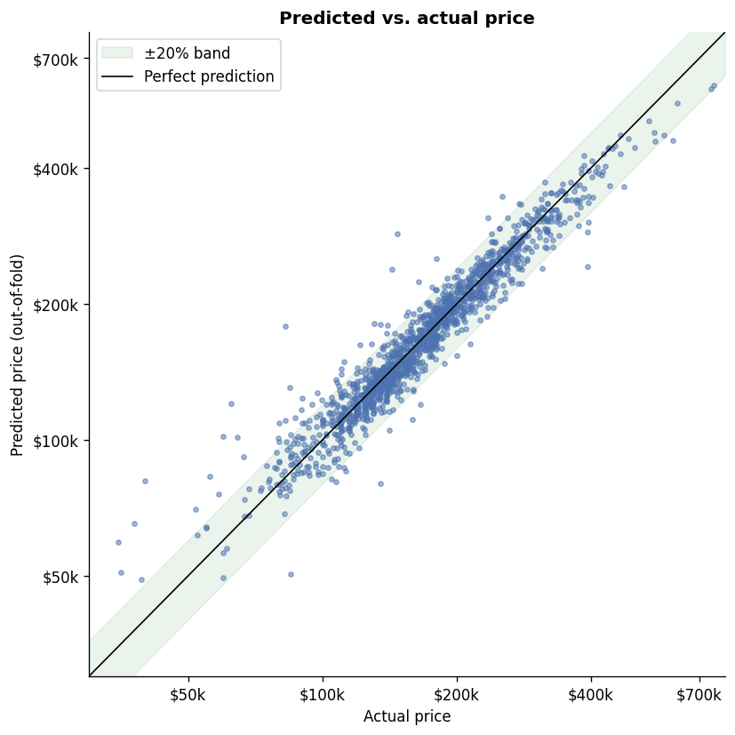
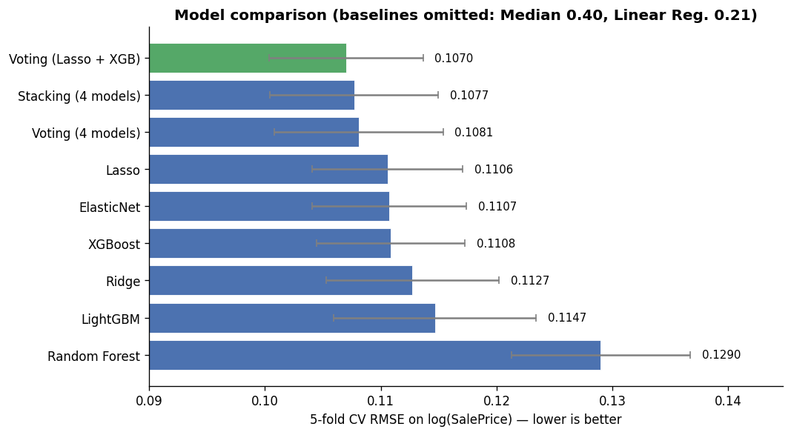
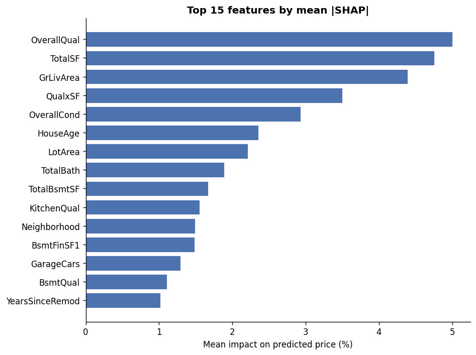
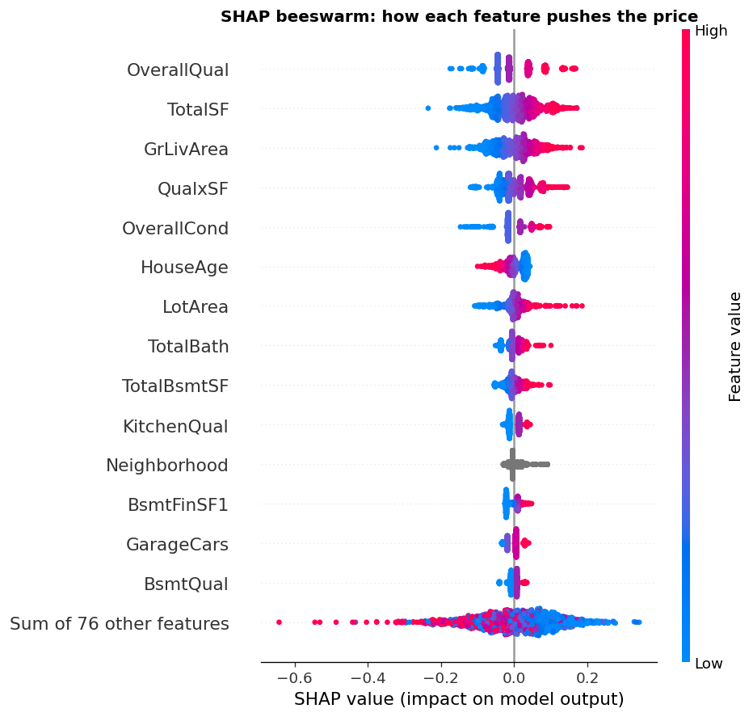
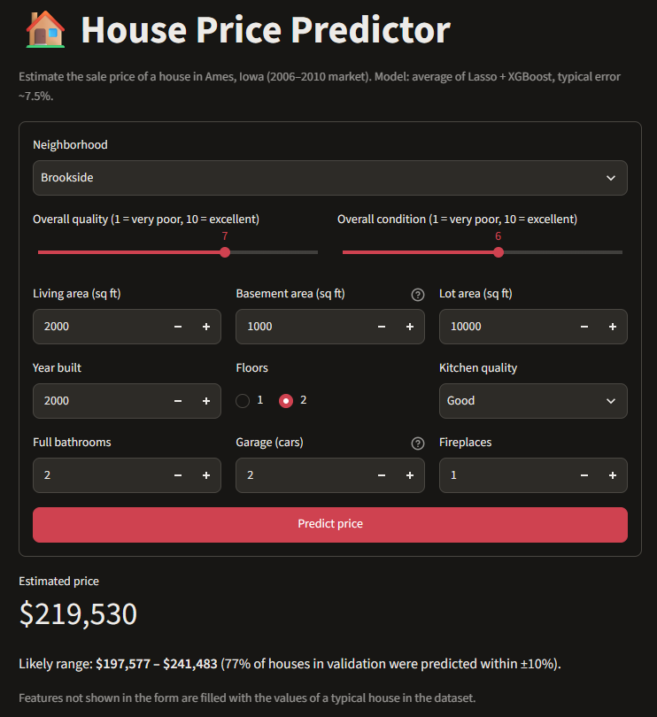

# 🏠 House Price Prediction

End-to-end machine learning project that predicts the sale price of residential homes in Ames, Iowa, from 79 features describing each property: from exploratory analysis to a leakage-free preprocessing pipeline, model comparison, interpretability with SHAP and a small Streamlit app.

**Dataset:** [Kaggle — House Prices: Advanced Regression Techniques](https://www.kaggle.com/c/house-prices-advanced-regression-techniques) (1,460 houses sold in 2006–2010).

---

## Results

| Metric | Value |
|---|---|
| **Kaggle public score** (RMSE on log price) | **0.12392** |
| 5-fold CV RMSE (log price) | 0.107 ± 0.007 |
| R² | 0.936 |
| Median absolute error | $8,788 |
| Mean absolute % error | 7.5% |
| Houses predicted within ±10% | 77% |

**Final model:** simple average of **Lasso + XGBoost**. A linear model and a tree-based model reach the same error on their own but make *different* mistakes, so averaging them beats both, as well as a 4-model stacking ensemble.

<p align="center">
  
  
</p>

---

## Highlights

- **Leakage-free preprocessing.** Every step (imputation, encoding, skew correction, scaling) lives inside one scikit-learn `Pipeline`, re-fitted in each cross-validation fold. It includes custom transformers, e.g. imputing `LotFrontage` with the median of the house's neighborhood.
- **Domain-driven feature engineering.** 12 new features (`TotalSF`, `QualxSF`, `HouseAge`, ...). Three of them end up among the 6 most important features of the final model.
- **Systematic model comparison.** Baselines, regularized linear models (tuned with `GridSearchCV`), Random Forest, LightGBM, XGBoost, voting and stacking, all evaluated on the same 5 folds.
- **Error analysis.** Errors are 2–3x larger for **non-market sales** (family sales, foreclosures): the model predicts what a house is worth in a normal sale, which those prices don't reflect.
- **Exact SHAP values for the ensemble.** Since the model is an average, its SHAP values are the average of linear SHAP (Lasso) and TreeSHAP (XGBoost). One-hot columns are grouped back into their original feature.

<p align="center">
  
  
</p>

---

## Approach

| Step | Notebook | Key decisions |
|---|---|---|
| **1. EDA** | [`01_eda`](notebooks/01_eda.ipynb) | Target is right-skewed (1.88) → model `log(SalePrice)` (skew 0.12). Most missing values mean "feature absent", not unknown. 2 clear outliers. Quality (r = 0.79) and size (r = 0.71) drive price. Strong multicollinearity. |
| **2. Preprocessing** | [`02_preprocessing`](notebooks/02_preprocessing.ipynb) | Structural NaN → `"None"`/0. Ordinal encoding for 16 quality-type features. 12 engineered features. `log1p` on 28 skewed features. Scaling + one-hot → 270 features. |
| **3. Modeling** | [`03_modeling`](notebooks/03_modeling.ipynb) | 11 models compared with 5-fold CV. Regularization fixes the unstable linear regression (0.209 → 0.111). Lasso keeps 109 / 270 features. |
| **4. Evaluation** | [`04_evaluation`](notebooks/04_evaluation.ipynb) | Out-of-fold error analysis by price range and sale type. Global and per-house SHAP explanations. |

| Model | CV RMSE (log) |
|---|---|
| Median baseline | 0.400 |
| Linear Regression | 0.209 (unstable) |
| Random Forest | 0.129 |
| LightGBM | 0.115 |
| Ridge | 0.113 |
| Lasso / ElasticNet / XGBoost | 0.111 |
| Stacking (4 models) | 0.108 |
| **Voting Lasso + XGBoost** | **0.107** |

📄 **Full step-by-step report (in Spanish):** [`docs/REPORTE.md`](docs/REPORTE.md). It explains every decision in plain language with figures and examples.

---

## Streamlit app

A simple app to estimate the price of a house from 12 key features. The remaining features are filled with the values of a typical house in the dataset.

```bash
python -m src.train      # trains the final model and saves it to models/
streamlit run app.py
```



---

## Project structure

```
house_price_prediction/
├── app.py                    # Streamlit app
├── data/                     # Kaggle data (not tracked by git)
├── docs/
│   ├── REPORTE.md            # Full project report (Spanish)
│   ├── make_figures.py       # Generates the report figures
│   ├── figures/              # Report figures
│   └── images/               # README images
├── models/                   # Trained model (created by src/train.py, not tracked)
├── notebooks/
│   ├── 01_eda.ipynb
│   ├── 02_preprocessing.ipynb
│   ├── 03_modeling.ipynb
│   └── 04_evaluation.ipynb
├── src/
│   ├── preprocessing.py      # Preprocessing pipeline and custom transformers
│   ├── models.py             # Model definitions and final ensemble
│   ├── explain.py            # SHAP values for the ensemble
│   ├── train.py              # Train and save the final model
│   └── predict.py            # Build a house from user inputs and predict
├── submissions/              # Kaggle submission
└── requirements.txt
```

---

## How to run

```bash
# 1. Environment
python -m venv venv
venv\Scripts\activate          # Windows  (macOS/Linux: source venv/bin/activate)
pip install -r requirements.txt

# 2. Data (requires a Kaggle API token)
kaggle competitions download -c house-prices-advanced-regression-techniques -p data
# unzip the downloaded file inside data/

# 3. Notebooks: run them in order (01 → 04)

# 4. App
python -m src.train
streamlit run app.py
```

---

## Limitations and next steps

- The data covers a single city and period (Ames, 2006–2010), so the model does not transfer directly to other markets or years.
- Non-market sales could be modeled separately, or excluded if the goal is to estimate market value.
- Gradient boosting hyperparameters could be tuned more systematically (e.g. with Optuna).

---

**Tech stack:** Python · pandas · NumPy · scikit-learn · XGBoost · LightGBM · SHAP · Matplotlib · Seaborn · Streamlit
