# Reporte del proyecto: Predicción del precio de casas

> **Para qué sirve este documento:** explicar, en lenguaje sencillo, todo lo que se hizo en el proyecto, cómo y por qué. Está pensado para repasarlo antes de una entrevista.
>
> Las figuras se generan con `python docs/make_figures.py`. Los detalles técnicos están en los notebooks (`notebooks/01` a `04`).

---

## Índice

0. [El proyecto en 1 minuto](#0-el-proyecto-en-1-minuto)
1. [El problema](#1-el-problema)
2. [El dataset](#2-el-dataset)
3. [Análisis exploratorio (EDA)](#3-análisis-exploratorio-eda)
4. [Preprocesado](#4-preprocesado)
5. [Modelado](#5-modelado)
6. [Resultados y evaluación](#6-resultados-y-evaluación)
7. [Interpretabilidad: ¿por qué predice lo que predice?](#7-interpretabilidad-por-qué-predice-lo-que-predice)
8. [Limitaciones y mejoras](#8-limitaciones-y-mejoras)
9. [Preguntas típicas de entrevista](#9-preguntas-típicas-de-entrevista)
10. [Glosario](#10-glosario)

---

## 0. El proyecto en 1 minuto

Construí un modelo que **predice el precio de venta de una casa** a partir de sus características (tamaño, calidad, barrio, antigüedad…), con datos reales de 1.460 casas vendidas en Ames, Iowa (EE. UU.) entre 2006 y 2010.

| Paso | Qué hice |
|---|---|
| EDA | Estudié los datos: el precio es asimétrico, hay datos faltantes que en realidad significan "no tiene", 2 outliers claros, y la calidad y el tamaño son lo que más influye. |
| Preprocesado | Construí un *pipeline* de scikit-learn que limpia, crea 12 variables nuevas y transforma todo a números **sin filtrar información del test** (*data leakage*). |
| Modelado | Comparé 11 modelos con validación cruzada. El mejor fue un **promedio de Lasso + XGBoost**. |
| Resultados | Error típico de **~7.5%** (mediana de ~$8.800). El 77% de las casas se predicen con menos de ±10% de error. **Kaggle: 0.12392** (puesto 1.438 cuando lo envié). |
| Interpretabilidad | Con **SHAP** expliqué qué variables suben o bajan el precio, tanto en general como para cada casa. |

---

## 1. El problema

**Pregunta:** dada una casa con sus características, ¿cuál será su precio de venta?

- Es un problema de **aprendizaje supervisado**: tenemos ejemplos con la respuesta correcta (casas ya vendidas con su precio) y el modelo aprende de ellos.
- Es de **regresión**, porque lo que predecimos es un **número continuo** (el precio). Si predijéramos una categoría ("cara" / "barata") sería clasificación.

**Para qué sirve en la vida real:** una inmobiliaria podría estimar el valor de una casa antes de ponerla a la venta, un banco podría comprobar si el precio de una hipoteca es razonable, o un comprador podría saber si le están cobrando de más.

**Cómo se mide el éxito:** con el **RMSE sobre el logaritmo del precio**, que es la métrica oficial de la competición de Kaggle. Explico por qué en la [sección 5.2](#52-la-métrica-rmse-en-escala-logarítmica).

---

## 2. El dataset

### 2.1 Origen

Es el **Ames Housing Dataset**, de la competición de Kaggle *House Prices: Advanced Regression Techniques*. Lo recopiló el profesor Dean De Cock como alternativa moderna al clásico dataset de Boston.

| Archivo | Contenido |
|---|---|
| `train.csv` | 1.460 casas **con** su precio → para entrenar |
| `test.csv` | 1.459 casas **sin** precio → Kaggle guarda la respuesta y evalúa nuestras predicciones |
| `data_description.txt` | Explicación de cada variable |

### 2.2 Las variables

Hay **79 variables** que describen cada casa (más el `Id` y el precio): **36 numéricas** (metros, años, número de baños…) y **43 categóricas** (barrio, tipo de tejado, calidad de la cocina…).

No hace falta memorizarlas todas. Se agrupan así:

| Grupo | Ejemplos | Qué describen |
|---|---|---|
| **Tamaño** | `GrLivArea`, `TotalBsmtSF`, `1stFlrSF`, `2ndFlrSF`, `LotArea` | Superficie habitable, sótano, cada planta, terreno |
| **Calidad y estado** | `OverallQual`, `OverallCond`, `KitchenQual`, `ExterQual` | Notas de 1 a 10, o de *Poor* a *Excellent* |
| **Antigüedad** | `YearBuilt`, `YearRemodAdd`, `YrSold` | Año de construcción, de reforma y de venta |
| **Ubicación** | `Neighborhood`, `MSZoning` | Barrio (25 en total) y tipo de zona (residencial, comercial…) |
| **Habitaciones** | `FullBath`, `HalfBath`, `BedroomAbvGr`, `TotRmsAbvGrd` | Baños, dormitorios, habitaciones |
| **Garaje** | `GarageCars`, `GarageArea`, `GarageType`, `GarageQual` | Capacidad, tamaño, tipo y calidad |
| **Sótano** | `BsmtQual`, `BsmtExposure`, `BsmtFinSF1` | Calidad, luz y superficie terminada |
| **Extras** | `PoolArea`, `Fireplaces`, `Fence`, `WoodDeckSF` | Piscina, chimeneas, valla, terraza |
| **Venta** | `SaleType`, `SaleCondition`, `MoSold` | Tipo de venta (normal, embargo, entre familiares…) y mes |

**Variable objetivo (*target*):** `SalePrice`, el precio en dólares. Va de $34.900 a $755.000, con una mediana de $163.000.

> **Unidades:** las superficies están en **pies cuadrados** (1 m² ≈ 10,8 pies²). Una casa de 1.500 pies² tiene unos 140 m².

---

## 3. Análisis exploratorio (EDA)

**¿Para qué sirve el EDA?** Es como revisar un coche usado antes de comprarlo: miras todo para detectar problemas y entender qué tienes entre manos. Antes de entrenar ningún modelo hay que saber:
- cómo es la variable que queremos predecir;
- qué datos faltan y por qué;
- qué variables se relacionan con el precio;
- si hay datos raros que puedan confundir al modelo.

Cada hallazgo del EDA se convirtió en una **decisión** del preprocesado (sección 4).

### 3.1 La variable objetivo: el precio

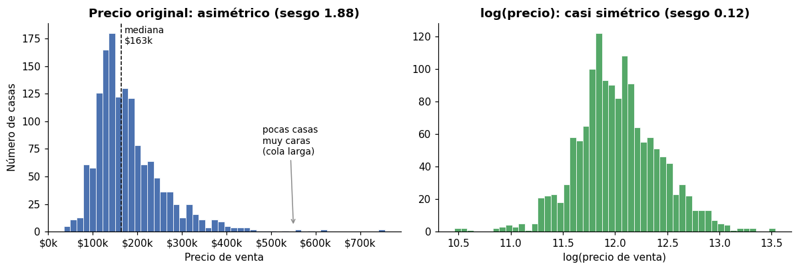

**Qué vemos:** la mayoría de las casas cuestan entre $100k y $250k, pero hay unas pocas muy caras que forman una "cola larga" a la derecha. Eso se llama **asimetría** (*skewness*), y aquí vale 1.88. Una distribución simétrica tendría asimetría 0.

**Ejemplo cotidiano:** pasa lo mismo con los sueldos de un país. Casi todos ganan cantidades parecidas y unos pocos ganan muchísimo. Si calculas la media, esos pocos la "estiran" hacia arriba.

**Por qué es un problema:** muchos modelos (sobre todo los lineales) funcionan mejor con datos simétricos. Además, las pocas casas carísimas tendrían demasiado peso en el error.

**Qué hicimos:** aplicar el **logaritmo** al precio. El logaritmo "comprime" los valores grandes: la diferencia entre $100k y $200k pasa a pesar lo mismo que entre $200k y $400k, porque las dos son "el doble". La asimetría baja de 1.88 a **0.12** (casi perfecta).

> **Cómo se usa:** el modelo aprende a predecir `log(precio)`, y al final deshacemos el logaritmo con la operación inversa (`exp`) para volver a dólares.

### 3.2 Datos faltantes

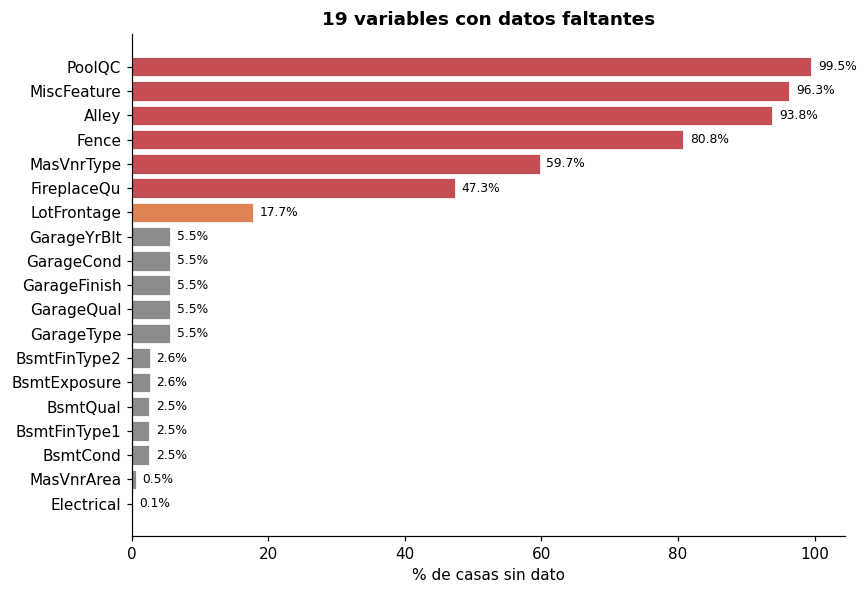

**Qué vemos:** 19 variables tienen huecos. Algunas casi no tienen datos: `PoolQC` (calidad de la piscina) falta en el 99,5% de las casas.

**La clave: no todos los huecos significan lo mismo.** Leyendo `data_description.txt` descubrimos dos tipos:

| Tipo | Ejemplo | Qué significa | Qué hicimos |
|---|---|---|---|
| **Estructural** | `PoolQC`, `Alley`, `Fence`, `GarageQual`, `BsmtQual` | La casa **no tiene** piscina, callejón, valla, garaje o sótano | Rellenar con `"None"` (o `0` en números) |
| **Real** | `LotFrontage` (17,7%) | El dato **existe pero no se registró** | Estimarlo (sección 4.4) |

**Ejemplo cotidiano:** en un formulario, la casilla *"Nombre de tu mascota"* vacía no es un error: significa "no tengo mascota". Borrar esas filas o rellenarlas con "el nombre más común" sería absurdo.

> **Detalle curioso:** `MasVnrType` (tipo de revestimiento de ladrillo) tenía la categoría `"None"` escrita en el archivo, y pandas la leyó como dato faltante. Por eso aparece con un 59,7% de huecos. Hay que conocer bien los datos para darse cuenta de estas cosas.

### 3.3 Correlación: ¿qué variables van de la mano con el precio?

**Qué es la correlación (r):** un número entre −1 y +1 que mide si dos variables **suben y bajan juntas en línea recta**.

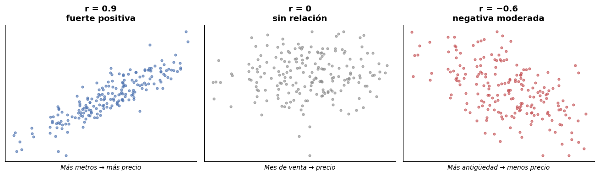

| Valor de r | Significado | Ejemplo |
|---|---|---|
| Cerca de **+1** | Cuando una sube, la otra también | Más metros → más precio |
| Cerca de **0** | No hay relación lineal | Mes de venta → precio |
| Cerca de **−1** | Cuando una sube, la otra baja | Más antigüedad → menos precio |

Como regla práctica: |r| > 0,7 es fuerte, 0,4–0,7 moderada y < 0,3 débil.

**Por qué la calculamos:** es una forma rápida de saber **qué variables tienen más información sobre el precio** y cuáles probablemente son relevantes para el modelo.

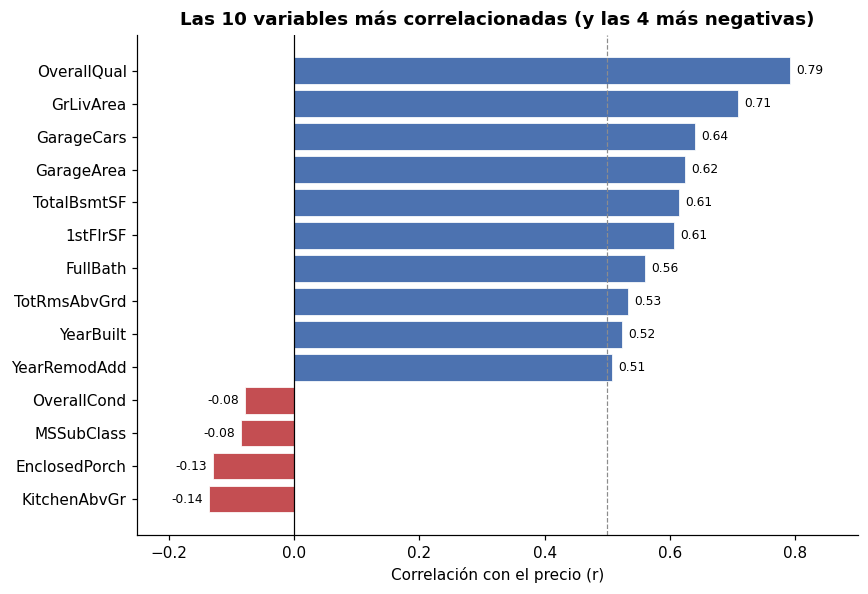

**Qué vemos:**
- **`OverallQual`** (calidad general) es la variable más correlacionada: **r = 0,79**.
- Le siguen el tamaño: `GrLivArea` (0,71), el garaje (0,64) y el sótano (0,61).
- Ninguna variable tiene una correlación negativa fuerte.

**⚠️ Dos limitaciones importantes:**
1. **Correlación no es causalidad.** En verano se venden más helados y también hay más ahogados, pero los helados no causan ahogamientos: los dos dependen del calor. Aquí pasa algo parecido: las casas grandes suelen tener garajes grandes, así que ambas variables se correlacionan con el precio.
2. **Solo mide relaciones en línea recta.** Si el precio sube rápido y luego se estanca, la correlación lo subestima. Por eso más adelante también usamos modelos de árboles, que captan relaciones curvas.

### 3.4 Calidad vs. precio: cómo leer un diagrama de caja (*boxplot*)

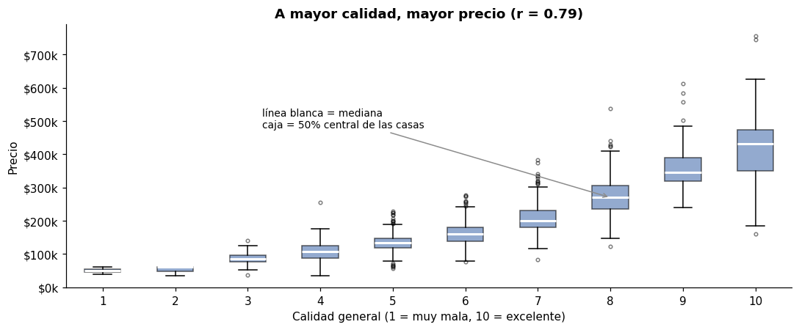

**Cómo se lee:**
- La **línea blanca** es la **mediana**: la casa "del medio" de ese grupo.
- La **caja** contiene el 50% central de las casas (del percentil 25 al 75).
- Los **bigotes** llegan hasta los valores normales más extremos.
- Los **puntos sueltos** son casas inusuales para su grupo.

**Qué vemos:** cada punto de calidad sube claramente el precio, y el salto es mayor en las calidades altas (de 8 a 10). Además, las cajas se hacen más anchas al subir la calidad: entre las casas de lujo hay más variedad de precios.

### 3.5 Diagrama de dispersión (*scatter plot*) y outliers

Un *scatter plot* pone cada casa como un punto. Sirve para ver la **forma** de la relación entre dos variables, no solo un número como la correlación.

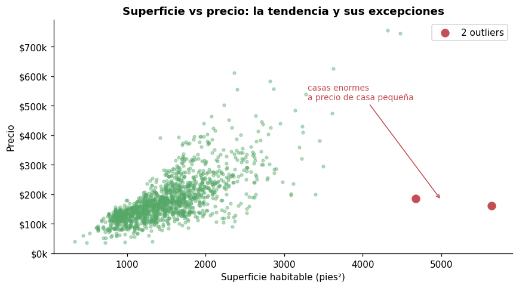

**Qué vemos:** a más superficie, más precio, con una tendencia clara. Pero hay **2 casas** (Ids 524 y 1299) de más de 4.000 pies² vendidas por menos de $200k. Esto rompe totalmente la tendencia.

**Qué son:** ventas *Partial* (casas nuevas sin terminar) en el barrio Edwards, con calidad 10. Probablemente son ventas atípicas (por ejemplo, de un terreno con la obra a medias) que no representan el mercado normal.

**Qué hicimos:** **eliminarlas del entrenamiento** (y solo del entrenamiento, nunca del test).

**Por qué:** un modelo lineal intenta pasar "cerca de todos los puntos". Estos dos puntos tiran de la línea hacia abajo y empeoran las predicciones de todas las casas grandes. Es como si en una encuesta de sueldos alguien escribiera $1 por error: arruina el promedio.

> **Cuidado:** eliminar outliers solo se justifica si son claramente anómalos y hay una razón. Eliminar datos "porque molestan" es hacer trampa. Aquí son solo 2 de 1.460, y el propio autor del dataset (De Cock) recomienda en su artículo revisar las casas de más de 4.000 pies².

### 3.6 Barrios: por qué usamos la mediana

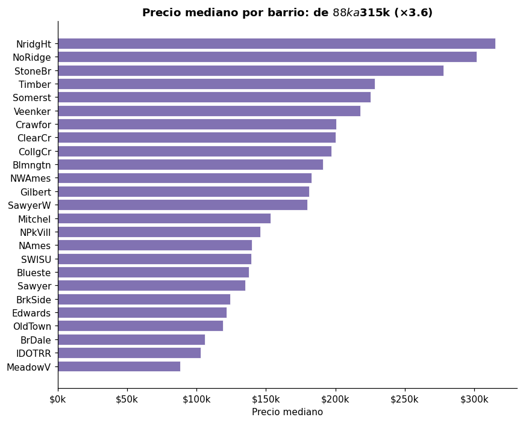

**Qué vemos:** el barrio importa muchísimo. El precio mediano va de **$88k** (MeadowV) a **$315k** (NridgHt): **3,6 veces más**.

**¿Por qué mediana y no media?** La mediana es el valor del medio y **no la afectan los extremos**. Ejemplo: en un bar hay 10 personas que ganan $30k al año. Entra un millonario que gana $10 millones. La **media** sube a casi $940k, pero la **mediana** sigue en $30k, que describe mucho mejor a la persona típica del bar. Como los precios son asimétricos (sección 3.1), la mediana es más representativa.

### 3.7 Multicolinealidad: variables que dicen lo mismo

En el *heatmap* de correlaciones del notebook vimos parejas de variables muy correlacionadas **entre sí**:

| Pareja | r | Por qué |
|---|---|---|
| `GarageCars` – `GarageArea` | 0,88 | Más coches caben en un garaje más grande |
| `GrLivArea` – `TotRmsAbvGrd` | 0,83 | Casa más grande, más habitaciones |
| `YearBuilt` – `GarageYrBlt` | 0,83 | El garaje se suele construir con la casa |
| `TotalBsmtSF` – `1stFlrSF` | 0,82 | El sótano suele estar debajo de la primera planta |

**Por qué importa:** es como tener dos testigos que cuentan exactamente la misma historia. No añaden información nueva, pero confunden al modelo lineal, que no sabe a cuál de los dos atribuirle el mérito. Sus coeficientes se vuelven inestables. **Solución:** regularización (sección 5.4).

### 3.8 Conclusiones del EDA → decisiones

| Hallazgo | Decisión |
|---|---|
| El precio es asimétrico (1,88) | Predecir `log(precio)` |
| La mayoría de los huecos significan "no tiene" | Rellenar con `"None"` / `0` |
| `LotFrontage` tiene huecos reales | Estimarlo con la mediana del barrio |
| 2 outliers claros | Eliminarlos del entrenamiento |
| Calidad y tamaño son lo más importante | Crear variables combinadas (tamaño total, calidad × tamaño) |
| Multicolinealidad | Usar modelos regularizados |
| El barrio importa mucho | Mantenerlo como variable categórica |

---

## 4. Preprocesado

**¿Qué es?** Transformar los datos "crudos" en una tabla **100% numérica, sin huecos y en un formato que el modelo pueda usar**. Un modelo es como una calculadora: no entiende "Excelente" ni "CollgCr", ni un hueco vacío.

### 4.1 La idea clave: un *pipeline* y evitar el *data leakage*

**Pipeline:** una "cadena de montaje" donde cada paso recibe el resultado del anterior. La definimos una sola vez en `src/preprocessing.py` y la aplicamos igual a cualquier dato: entrenamiento, test o una casa nueva.

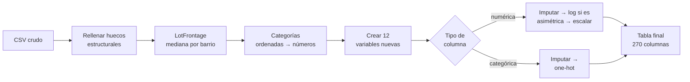

**Data leakage (fuga de información):** ocurre cuando el modelo, sin querer, ve información del conjunto que se usará para evaluarlo.

**Ejemplo cotidiano:** un profesor prepara a sus alumnos con preguntas sacadas del examen final. Las notas salen muy altas, pero no reflejan lo que de verdad saben. Si calculo la mediana de `LotFrontage` usando **todas** las casas (incluidas las de evaluación), estoy "filtrando" información del examen.

**Cómo lo evitamos:** todo lo que se "aprende" de los datos (medianas, qué variables son asimétricas, la media y desviación para escalar, las categorías posibles) se calcula **solo con los datos de entrenamiento**, dentro del pipeline. Durante la validación cruzada, el pipeline se vuelve a ajustar en cada ronda solo con la parte de "estudio".

### 4.2 Eliminar outliers y transformar el precio

- Quitamos las 2 casas anómalas → quedan **1.458** casas de entrenamiento.
- `y = log(1 + precio)`. Se usa `log1p` (logaritmo de 1 + x) por convención, porque funciona aunque haya ceros.

### 4.3 Rellenar los huecos estructurales

- 15 variables categóricas (`PoolQC`, `Alley`, `GarageType`, `BsmtQual`…) → `"None"`.
- 9 variables numéricas (`GarageArea`, `TotalBsmtSF`, `MasVnrArea`…) → `0`. Sin garaje, el área del garaje es 0.
- `GarageYrBlt` (año del garaje) → el año de la casa, porque un "año 0" no tendría sentido.
- `Functional` → `"Typ"` (típico), porque la documentación dice "asumir típico salvo indicación".

**Resultado:** las variables con huecos (sumando train y test) pasan de **34 a 8**. Los pocos huecos que quedan (1–4 casas por variable) se rellenan después con la mediana o el valor más frecuente, aprendidos de train.

### 4.4 `LotFrontage`: la mediana del barrio

`LotFrontage` son los pies de calle que tiene el frente del terreno. Falta en el 17,7% de las casas y aquí el hueco es real.

**Opción simple:** rellenar con la mediana global (69 pies). **Opción mejor:** usar la **mediana de su barrio**, porque en un mismo barrio los terrenos suelen ser parecidos. Las medianas por barrio van de 21 a 91 pies: usar la global sería un error grande en muchos barrios.

**Ejemplo cotidiano:** si no sabes cuánto mide alguien, adivinar "la altura media de su equipo de baloncesto" es mejor que "la altura media de la población".

Lo implementé como una clase propia (`GroupMedianImputer`) que aprende las medianas en `fit` (solo train) y las aplica en `transform`. Si aparece un barrio nuevo, usa la mediana global.

### 4.5 Codificación ordinal: categorías con orden

Muchas variables de calidad son textos con un **orden natural**: `Po` (pobre) < `Fa` (regular) < `TA` (típico) < `Gd` (bueno) < `Ex` (excelente).

Las convertimos a números que **respetan ese orden**: `None`=0, `Po`=1, `Fa`=2, `TA`=3, `Gd`=4, `Ex`=5. Lo hicimos para **16 variables**: calidades, exposición del sótano, acabado del garaje, funcionalidad y aire acondicionado.

**Ejemplo cotidiano:** las tallas de ropa S < M < L < XL. Tiene sentido convertirlas en 1, 2, 3, 4, porque una L está "más cerca" de una XL que de una S.

**Por qué no usar one-hot aquí:** perderíamos el orden (el modelo no sabría que "Excelente" > "Bueno") y crearíamos 6 columnas en vez de 1.

### 4.6 Ingeniería de variables (*feature engineering*)

Crear variables nuevas a partir de las existentes, usando **conocimiento del problema**:

| Variable nueva | Cómo se calcula | Por qué |
|---|---|---|
| `TotalSF` | sótano + 1ª planta + 2ª planta | El comprador valora el espacio total |
| `TotalBath` | baños completos + 0,5 × medios baños (incluido el sótano) | Un único número de baños |
| `TotalPorchSF` | suma de todos los porches y terrazas | Junta 5 variables con muchos ceros |
| `HouseAge` | año de venta − año de construcción | La antigüedad *en el momento de la venta* |
| `YearsSinceRemod` | año de venta − año de reforma | Cuánto hace de la última reforma |
| `IsRemodeled` | ¿se ha reformado? (0/1) | |
| `QualxSF` | calidad × superficie habitable | **Interacción**: una casa grande *y* de calidad vale mucho más que la suma de ambas cosas |
| `HasPool`, `HasGarage`, `HasBsmt`, `HasFireplace`, `Has2ndFloor` | ¿lo tiene? (0/1) | Tener o no tener puede importar más que el tamaño exacto |

**¿Funcionó?** Sí: `QualxSF` (r = 0,84) y `TotalSF` (0,83) tienen **más correlación con el precio que cualquier variable original**. Y en la interpretabilidad (sección 7), 3 de las 6 variables más importantes son inventadas por nosotros.

También convertimos `MSSubClass` (tipo de vivienda) y `MoSold` (mes) a texto: son números que en realidad son **etiquetas**. El mes 12 no es "el doble" del mes 6. Y eliminamos `Id` (no aporta información) y `Utilities` (todas las casas menos una tienen el mismo valor).

### 4.7 Corregir la asimetría de otras variables

Igual que el precio, muchas variables de superficie son asimétricas. Aplicamos `log` a las **28 variables numéricas** con asimetría > 0,75 (calculada solo en train).

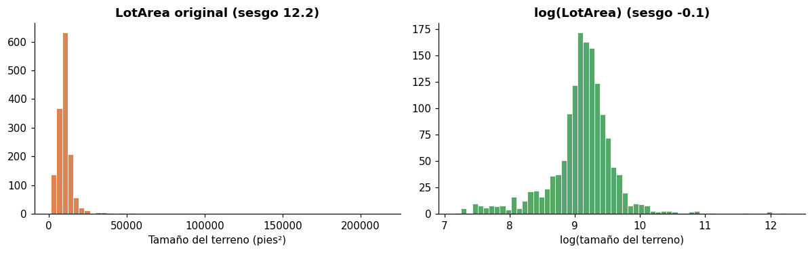

Esto ayuda sobre todo a los **modelos lineales**. A los modelos de árboles les da igual, porque solo hacen preguntas del tipo "¿es mayor que X?", y el orden de los valores no cambia con el logaritmo.

### 4.8 Escalado (*StandardScaler*)

Transforma cada variable numérica para que tenga **media 0 y desviación 1**.

**Por qué:** las variables tienen escalas muy distintas (terreno ~10.000 pies², baños ~2). Los modelos regularizados (sección 5.4) penalizan el tamaño de los coeficientes, y sin escalar penalizarían de forma injusta según las unidades. **Ejemplo:** comparar el precio de un coche en euros con el de una casa en millones de euros. Hay que ponerlos en la misma "moneda".

### 4.9 One-hot encoding: categorías sin orden

Para las categorías **sin orden** (barrio, tipo de tejado…) creamos una columna 0/1 por cada valor:

| Neighborhood | → | Neighborhood_CollgCr | Neighborhood_Edwards | Neighborhood_OldTown | … |
|---|---|---|---|---|---|
| Edwards | → | 0 | 1 | 0 | … |

**Por qué no usar números 1, 2, 3:** el modelo pensaría que el barrio 3 es "el triple" del barrio 1, y eso no tiene sentido.

**Detalle:** `handle_unknown='ignore'` hace que, si en el test aparece una categoría que no estaba en train, se ignore en vez de dar un error.

### 4.10 Resultado

| Antes | Después |
|---|---|
| 79 variables, mezcla de texto y números, 19 con huecos | **270 columnas numéricas, 0 huecos**, en train y en test |

**Prueba rápida:** una regresión Ridge con este preprocesado obtiene un error de **0,113**, ya muy bueno. El preprocesado funciona.

---

## 5. Modelado

### 5.1 Entrenar y evaluar: la validación cruzada

**El problema:** si evalúo el modelo con las mismas casas con las que aprendió, es como preguntarle a un alumno las mismas preguntas que ya estudió. Sacará un 10 aunque solo haya memorizado.

**La solución: validación cruzada de 5 *folds*.**

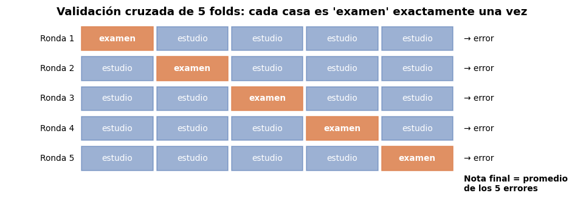

1. Divido las casas en 5 grupos.
2. Entreno con 4 grupos ("estudio") y evalúo con el que queda ("examen").
3. Repito 5 veces, cambiando el grupo de examen.
4. La nota final es el **promedio de los 5 errores**. La **desviación** entre las 5 notas indica cuánto podemos fiarnos de ella.

**Ventajas:** todas las casas se usan para evaluar exactamente una vez, y el resultado es más fiable que con una sola división. Usé **los mismos 5 grupos para todos los modelos** (`random_state=42`), para que la comparación sea justa.

### 5.2 La métrica: RMSE en escala logarítmica

**RMSE** (*Root Mean Squared Error*): la raíz del promedio de los errores al cuadrado. Al elevar al cuadrado, **los errores grandes se castigan más**.

**¿Por qué sobre el logaritmo del precio?** Porque así se mide el error **relativo** (en %), no absoluto.

**Ejemplo:** equivocarse en $20.000 es grave en una casa de $60.000 (33%), pero poca cosa en una de $600.000 (3%). Con el logaritmo, los dos errores se miden en proporción a lo que vale cada casa. Así las casas caras no dominan la métrica.

**Cómo leerlo:** un RMSE (log) de **0,11 ≈ un error típico del 11-12%**.

### 5.3 Modelos de referencia (*baselines*)

Antes de usar modelos complejos hay que saber **cuál es el mínimo a superar**.

| Modelo | Error | Qué nos dice |
|---|---|---|
| **Predecir siempre la mediana** | 0,400 | "No saber nada". Cualquier modelo útil debe mejorarlo |
| **Regresión lineal** | 0,209 ± **0,147** | Mucho mejor en promedio, pero **muy inestable**: en algún fold se dispara |

**¿Por qué falla la regresión lineal?** Con 270 columnas, muchas correlacionadas entre sí (multicolinealidad, sección 3.7), los coeficientes se vuelven enormes y se compensan entre ellos. Es como los dos testigos que cuentan la misma historia: el modelo no sabe a quién creer y da pesos absurdos a los dos.

### 5.4 Modelos lineales regularizados: Ridge, Lasso y ElasticNet

**Regularización:** añadir al modelo una **penalización por usar coeficientes grandes**. El modelo tiene que equilibrar dos cosas: ajustarse a los datos y mantener los coeficientes pequeños.

**Ejemplo cotidiano:** un "impuesto a la complejidad". Si cada coeficiente grande cuesta dinero, el modelo solo los usará cuando de verdad valga la pena.

| Modelo | Tipo de penalización | Efecto |
|---|---|---|
| **Ridge** (L2) | Suma de coeficientes **al cuadrado** | Encoge todos los coeficientes, pero ninguno llega a 0 |
| **Lasso** (L1) | Suma de coeficientes **en valor absoluto** | Pone muchos coeficientes **exactamente a 0** → **selecciona variables** |
| **ElasticNet** | Mezcla de ambas | Un punto intermedio |

**El parámetro `alpha`:** controla la fuerza de la penalización. Si es muy bajo, volvemos a la regresión lineal inestable; si es muy alto, el modelo se vuelve demasiado simple.

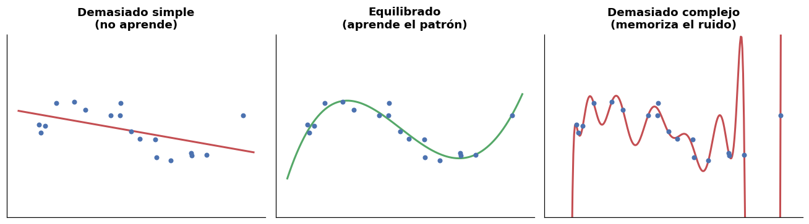

Esto ilustra el **equilibrio entre sobreajuste y subajuste**: queremos un modelo que aprenda el patrón (centro), no uno que no aprenda nada (izquierda) ni uno que memorice el ruido (derecha). Un modelo sobreajustado acierta en el entrenamiento y falla con datos nuevos.

**Cómo elegimos `alpha`:** con `GridSearchCV`, que prueba varios valores y se queda con el que da menor error en validación cruzada.

| Modelo | Mejor parámetro | Error |
|---|---|---|
| Ridge | alpha = 20 | 0,113 |
| **Lasso** | alpha = 0,0005 | **0,111** |
| ElasticNet | alpha = 0,001, mezcla 50/50 | 0,111 |

**Resultado:** de 0,209 (inestable) a **0,111** (estable). Lasso se queda solo con **109 de las 270 variables**: hizo selección de variables automáticamente.

### 5.5 Modelos de árboles: Random Forest, LightGBM y XGBoost

**Árbol de decisión:** una serie de preguntas sí/no, como el juego de las "20 preguntas".

> ¿Calidad ≥ 7? → Sí → ¿Superficie > 2.000? → Sí → **precio ≈ $320k**

Los árboles captan **relaciones no lineales** (por ejemplo, "a partir de cierto tamaño el precio se estanca") e **interacciones** sin que se las indiquemos. Un solo árbol, eso sí, es muy inestable.

| Modelo | Idea | Ejemplo cotidiano |
|---|---|---|
| **Random Forest** | Cientos de árboles independientes, cada uno con datos y variables un poco distintos. Se promedian | La **sabiduría de la multitud**: el promedio de muchas opiniones independientes suele acertar más que un experto solo |
| **Gradient Boosting** (LightGBM, XGBoost) | Árboles **en secuencia**: cada uno se centra en **corregir los errores** de los anteriores | Un estudiante que, después de cada examen de práctica, estudia **solo lo que falló** |

**Hiperparámetros elegidos** (los mismos en XGBoost y LightGBM):
- **Muchos árboles (2.000) con un aprendizaje lento** (`learning_rate=0.01`): avanzar a pasos pequeños es más seguro.
- **Árboles poco profundos** (`max_depth=3`): cada árbol aprende algo simple y es más difícil memorizar.
- **Submuestreo** (70% de las casas y 30% de las variables en cada árbol): añade variedad y reduce el sobreajuste.

Es una configuración **conservadora**, adecuada para un dataset pequeño (~1.500 casas).

| Modelo | Error |
|---|---|
| Random Forest | 0,129 |
| LightGBM | 0,115 |
| **XGBoost** | **0,111** |

El boosting supera al Random Forest, y **XGBoost empata con Lasso**.

### 5.6 Ensembles: combinar modelos

**Idea:** Lasso (lineal) y XGBoost (árboles) tienen el **mismo error**, pero piensan de forma muy distinta, así que **se equivocan en casas diferentes**. Si los promediamos, los errores se compensan en parte.

**Ejemplo cotidiano:** para valorar una casa, le preguntas a un **tasador** (que aplica fórmulas: "tantos euros por metro") y a un **agente inmobiliario** (que piensa por reglas: "en este barrio, si tiene jardín…"). El promedio de los dos suele ser mejor que cualquiera de ellos por separado.

| Ensemble | Cómo combina | Error |
|---|---|---|
| Voting (4 modelos) | Promedio de Lasso, Ridge, XGBoost y LightGBM | 0,108 |
| Stacking (4 modelos) | Un modelo "jefe" aprende cuánto confiar en cada uno | 0,108 |
| **Voting Lasso + XGBoost** | **Promedio simple de los dos mejores** | **0,107** |

### 5.7 Comparación final y elección

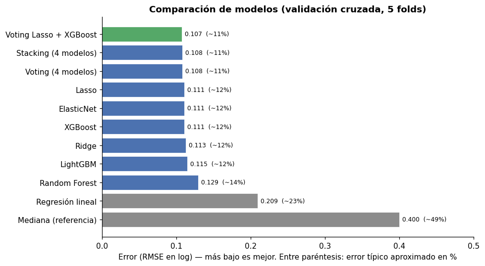

**Modelo elegido: Voting (Lasso + XGBoost)**, por tres razones:
1. **El mejor error** (0,107), un 73% menos que el baseline.
2. **El más simple** entre los mejores: solo 2 modelos y un promedio, sin "modelo jefe".
3. **Combina dos formas de pensar complementarias:** lineal + árboles.

El *stacking* no mejora y es 4 veces más lento. **Ante un empate, el modelo más simple gana.**

> **Honestidad estadística:** las diferencias entre los mejores modelos (~0,003) son **menores que la variación entre folds** (±0,007). Además, elegir "el mejor de varios" con los mismos datos es un poco optimista. La prueba real es Kaggle, con casas que el modelo nunca ha visto.

Al final se entrena el modelo con **todas** las casas de entrenamiento y se predice el test (convirtiendo de log a dólares) para enviarlo a Kaggle.

---

## 6. Resultados y evaluación

### 6.1 Predicciones honestas (*out-of-fold*)

Para analizar los errores necesitamos una predicción de cada casa **hecha por un modelo que no la vio**. Usamos `cross_val_predict` con los mismos 5 folds: cada casa se predice con el modelo entrenado en los otros 4 grupos.

### 6.2 Métricas en dólares

| Métrica | Valor | Qué significa |
|---|---|---|
| RMSE (log) | 0,107 | La métrica de Kaggle |
| **R²** | **0,936** | El modelo explica el **94% de las diferencias de precio** entre casas |
| **Error mediano** | **$8.788** | En una casa típica, la predicción se desvía menos de $9k |
| Error medio (MAE) | $12.937 | Es mayor que la mediana porque unos pocos errores grandes lo suben |
| **Error medio en %** (MAPE) | **7,5%** | |
| Casas con error < ±10% | **77%** | |
| Casas con error < ±20% | **95%** | |

**Cómo explicar el R² con un ejemplo:** si predijeras siempre el precio medio, tu R² sería 0. Si acertaras siempre, sería 1. Con 0,94, el modelo explica casi todo lo que hace que unas casas valgan más que otras.

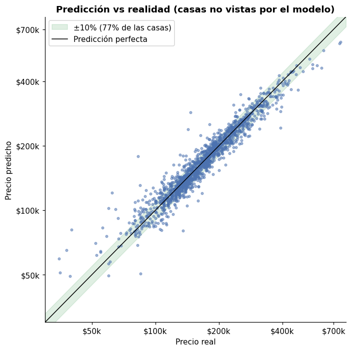

Cada punto es una casa. Si el modelo fuera perfecto, todos estarían sobre la línea negra. La franja verde marca ±10%.

### 6.3 Kaggle: la prueba con datos nunca vistos

**Score en Kaggle: 0,12392** (puesto 1.438 en el momento del envío; el puesto puede cambiar porque otros siguen enviando).

**¿Por qué es peor que en validación cruzada (0,107)?** Es lo esperado:
- el test tiene **casas distintas**, algunas quizás más difíciles;
- con ~1.500 casas, el resultado tiene algo de **azar**: según qué casas toquen, el error sube o baja un poco;
- elegir el mejor modelo con los mismos folds de validación es ligeramente optimista (sección 5.7).

Que la diferencia sea pequeña indica que **el modelo no está sobreajustado**.

### 6.4 ¿Dónde se equivoca el modelo?

**Por rango de precio:**

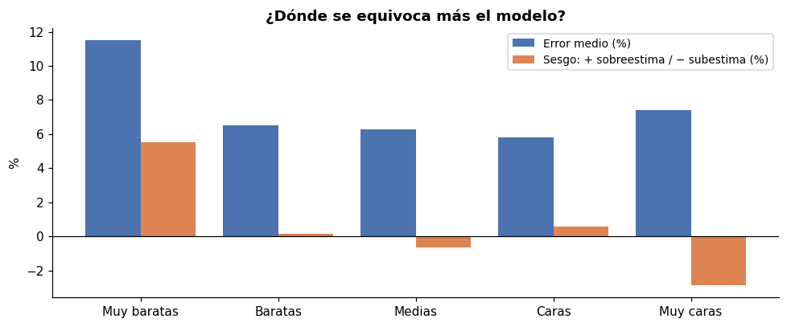

- Es **más preciso en el centro del mercado** (~6% de error), donde hay más datos.
- En las **casas muy baratas** el error es mayor (~11,5%) y **las sobreestima** (+5%). Las **muy caras** las subestima ligeramente (−3%).
- Esto se llama **regresión a la media**: en los extremos hay pocos ejemplos, así que el modelo "tira" sus predicciones hacia precios típicos. Es como cuando un examen difícil hace que las notas de los mejores bajen y las de los peores suban.

**Por tipo de venta (el hallazgo más interesante):**

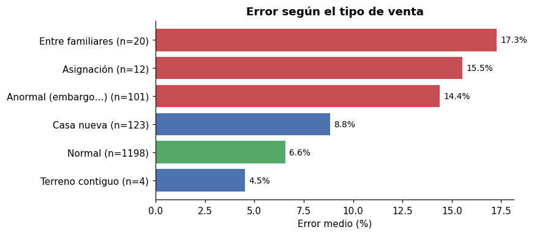

- En las **ventas normales** (82% de los datos), el error es solo del **6,6%**.
- En las **ventas entre familiares, asignaciones y ventas anormales** (embargos, ventas urgentes), el error es **2-3 veces mayor**, y casi siempre sobreestima el precio.
- **Por qué:** esos precios **no los fija el mercado**. Un padre puede venderle la casa barata a su hijo; un banco que embarga quiere vender rápido. Las características de la casa no pueden explicar eso.
- De las 10 peores predicciones, **7 son ventas no normales**, y en las 10 el modelo predijo **más** de lo que se pagó (casi todas casas baratas). El modelo no se "equivoca" sobre la casa: predice lo que valdría **en una venta normal**.

---

## 7. Interpretabilidad: ¿por qué predice lo que predice?

**Por qué es importante:** un modelo que acierta pero no se puede explicar genera desconfianza. Si un banco te niega una hipoteca, quieres saber por qué. Además, explicar el modelo permite **detectar errores** (¿está usando algo que no debería?) y **comprobar que tiene sentido** con lo que sabemos del negocio.

### 7.1 Coeficientes de Lasso

En un modelo lineal, cada coeficiente dice cuánto cambia la predicción cuando sube esa variable. Algunos ejemplos de nuestro Lasso:
- Estar en el barrio **Crawford**: **+11%** en el precio.
- Zona **comercial** (`MSZoning_C`): **−25%**.
- Casa **nueva** (`SaleType_New`): sube; venta **anormal**: baja.

**Limitación:** con variables correlacionadas, los coeficientes se "reparten" el mérito de forma rara. Por ejemplo, `HasBsmt` sale negativo porque `TotalBsmtSF` ya recoge el efecto del sótano. Hay que leerlos en grupo.

### 7.2 SHAP: repartir el mérito de cada predicción

**SHAP** (*SHapley Additive exPlanations*) viene de la **teoría de juegos**. Responde a la pregunta: *"de la diferencia entre el precio de esta casa y el precio promedio, ¿cuánto se debe a cada variable?"*

**Ejemplo cotidiano:** un equipo de 3 personas gana un premio de $900. ¿Cómo lo repartes de forma justa? Los valores de Shapley calculan cuánto aportó cada uno, teniendo en cuenta todas las combinaciones posibles de equipo. SHAP hace lo mismo con las variables y el precio.

**Propiedad clave:** `precio predicho = precio promedio + suma de las contribuciones`. Siempre cuadra exactamente; lo comprobé en el notebook, con un error de 0,00002.

**Detalle técnico (para impresionar):** como el modelo final es un **promedio** de Lasso y XGBoost, sus valores SHAP son **exactamente el promedio** de los SHAP de cada modelo: la fórmula lineal para Lasso y TreeSHAP para XGBoost. Además, sumé las columnas one-hot para que el barrio aparezca como una sola variable (`Neighborhood`) y no como 25.

### 7.3 ¿Qué variables pesan más?

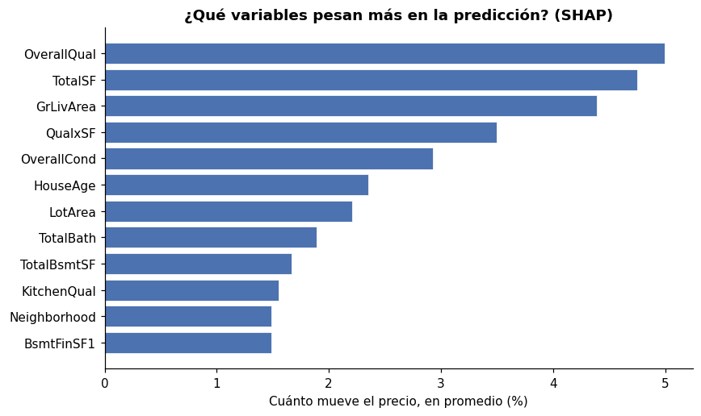

1. **Calidad general** (`OverallQual`): mueve el precio un ~5% de media.
2. **Tamaño** (`TotalSF`, `GrLivArea`) y su **interacción con la calidad** (`QualxSF`).
3. **Estado** (`OverallCond`) y **antigüedad** (`HouseAge`).
4. Después: terreno, baños, sótano, cocina y barrio.

**3 de las 6 más importantes las creamos nosotros** (`TotalSF`, `QualxSF`, `HouseAge`): la ingeniería de variables funcionó.

### 7.4 ¿Cómo afecta cada variable?

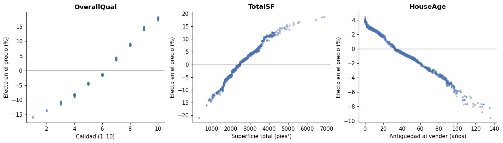

- **Calidad:** cada punto extra suma ~4-5%. Una casa de calidad 10 vale un ~18% más que una casa promedio, y una de calidad 1, un ~16% menos.
- **Superficie:** más espacio siempre suma, pero cada vez menos a partir de ~4.000 pies² (**rendimientos decrecientes**). Ejemplo: pasar de 80 a 120 m² te cambia la vida; pasar de 400 a 440 m², casi nada.
- **Antigüedad:** resta de forma constante, aproximadamente **1% por década**.
- **Barrio:** *después* de tener en cuenta el tamaño y la calidad, el barrio mueve el precio de −3% (Edwards) a +9% (Crawford). Es mucho menos que la diferencia de ×3,6 que vimos en el EDA, porque **gran parte de esa diferencia se debía a que en los barrios caros hay casas más grandes y de mejor calidad**. Esto muestra la diferencia entre correlación y efecto real.

### 7.5 Explicar una casa concreta

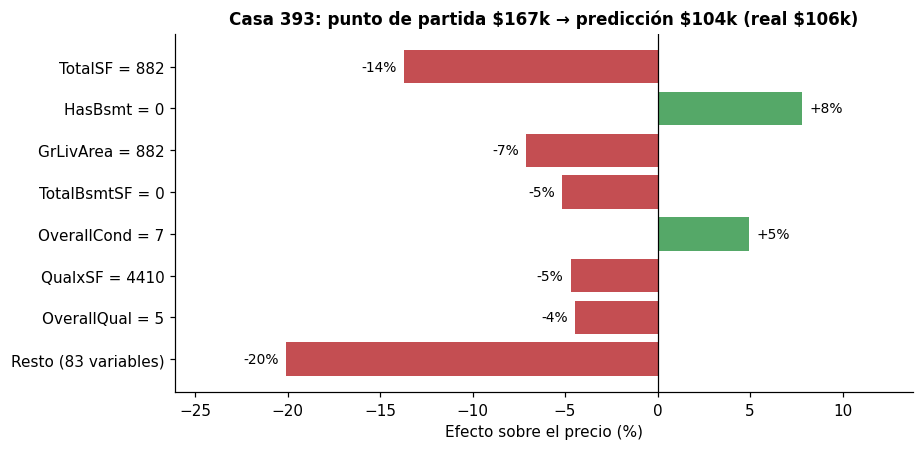

**Casa 393:** precio real $106.500, predicción $104.450 (error del 2%).

**Cómo se lee:** se parte del precio promedio ($167k) y cada barra lo empuja hacia arriba (verde) o hacia abajo (rojo).
- Es **pequeña** (882 pies², ~82 m²): −14% por superficie total, −7% por superficie habitable.
- Su **calidad es media** (5): −4%.
- Pero está en **buen estado** (`OverallCond` = 7): +5%.
- El resto de variables (barrio, garaje, baños…) suman un −20%.

> Los porcentajes se **multiplican**, no se suman: el precio final es $167k × 0,86 × 1,08 × 0,93 × …

El `HasBsmt = 0 → +8%` parece raro: no tener sótano ¿sube el precio? En realidad **compensa** que la falta de sótano ya se ha penalizado en `TotalBsmtSF` (−5%), `TotalSF` y la calidad del sótano. Variables relacionadas se reparten el mérito y hay que leerlas juntas.

Así se le podría explicar a un cliente: *"su casa vale menos que el promedio porque es pequeña y de calidad media, aunque su buen estado de conservación la ayuda"*.

### 7.6 Advertencia: el modelo no es causal

SHAP explica **cómo razona el modelo**, no cómo funciona el mundo. Que `OverallQual` tenga mucho peso no garantiza que reformar la cocina suba el precio exactamente eso. Para afirmaciones causales harían falta otros métodos (experimentos, inferencia causal).

---

## 8. Limitaciones y mejoras

**Limitaciones:**
- **Una sola ciudad y una sola época** (Ames, 2006-2010). No serviría directamente para Madrid o para 2025: los precios y lo que valora la gente cambian.
- **Poca cantidad de datos** (~1.500 casas). Por eso hay más error en los extremos.
- **Ventas no de mercado:** el modelo no puede predecir precios que no dependen de la casa.

**Posibles mejoras:**
- Ajustar los hiperparámetros de XGBoost y LightGBM de forma más sistemática (por ejemplo, con **Optuna**).
- Tratar aparte las ventas no normales, o excluirlas si el objetivo es estimar el valor de mercado.
- Pasar el modelo a producción: un script `predict.py` o una pequeña app (por ejemplo, con Streamlit) donde se introducen los datos de una casa y devuelve el precio con su explicación.

---

## 9. Preguntas típicas de entrevista

**¿Por qué transformaste el precio con logaritmo?**
> Porque era asimétrico (1,88). Con el log queda casi simétrico (0,12), lo que ayuda a los modelos lineales, y el error pasa a medirse en términos relativos: equivocarse en $20k pesa distinto en una casa de $60k que en una de $600k. Además, es la métrica oficial de la competición.

**¿Cómo trataste los datos faltantes?**
> Primero entendí qué significaban. En la mayoría (piscina, garaje, sótano…) un hueco significa "no tiene", así que los rellené con "None" o 0. Solo `LotFrontage` tenía huecos reales: lo imputé con la mediana de su barrio, calculada solo con los datos de entrenamiento.

**¿Qué es el data leakage y cómo lo evitaste?**
> Es cuando el modelo ve información de los datos de evaluación durante el entrenamiento y las métricas salen mejores de lo que son. Lo evité metiendo todo el preprocesado en un Pipeline de scikit-learn dentro de la validación cruzada, de forma que cada fold aprende las medianas, el escalado, etc., solo de su parte de entrenamiento.

**¿Por qué eliminaste outliers? ¿No es hacer trampa?**
> Solo eliminé 2 casas, claramente anómalas: más de 4.000 pies² vendidas por menos de $200k, ventas parciales de casas sin terminar. Rompían la tendencia general y distorsionaban los modelos lineales. El autor del dataset también recomienda revisarlas. Nunca eliminé datos del test.

**¿Por qué Lasso funcionó mejor que la regresión lineal?**
> Por la multicolinealidad. Con 270 variables, muchas correlacionadas, la regresión lineal da coeficientes inestables (variaba mucho entre folds). Lasso penaliza los coeficientes grandes y además pone a cero los irrelevantes: se quedó con 109 de 270.

**¿Diferencia entre Random Forest y Gradient Boosting?**
> Random Forest entrena muchos árboles **independientes** y los promedia (reduce la varianza). Boosting entrena árboles **en secuencia**, cada uno corrigiendo los errores de los anteriores (reduce el sesgo). En datos tabulares, el boosting suele ganar, como aquí.

**¿Por qué un ensemble de Lasso + XGBoost?**
> Porque tenían el mismo error pero se equivocaban en casas diferentes: uno es lineal y el otro de árboles. Promediarlos redujo el error de 0,111 a 0,107. Probé también stacking, pero no mejoró y era 4 veces más lento, así que elegí lo más simple.

**¿Cómo sabes que el modelo no está sobreajustado?**
> Usé validación cruzada de 5 folds con poca variación entre ellos (±0,007), y el resultado en Kaggle con datos nunca vistos (0,124) fue cercano al de la validación cruzada (0,107).

**¿Dónde falla el modelo?**
> En casas muy baratas, que sobreestima (regresión a la media), y sobre todo en ventas que no son de mercado: entre familiares, embargos. Ahí el error es 2-3 veces mayor, porque el precio no depende de las características de la casa.

**¿Qué es SHAP y por qué lo usaste?**
> Es un método basado en la teoría de juegos que reparte cada predicción entre las variables, de forma que la suma de las contribuciones da exactamente la predicción. Lo usé para ver qué variables importan más en general y para explicar casas concretas. Confirmó que calidad, tamaño, estado, antigüedad y barrio son los factores principales.

**¿Qué mejorarías?**
> Ajustar los hiperparámetros del boosting con Optuna, tratar aparte las ventas no normales, y crear un script o una app para usar el modelo con casas nuevas.

---

## 10. Glosario

| Término | Significado sencillo |
|---|---|
| **Asimetría (*skewness*)** | Cuánto "se inclina" una distribución hacia un lado. 0 = simétrica |
| **Baseline** | Modelo muy simple que sirve de referencia mínima |
| **Coeficiente** | En un modelo lineal, el "peso" de cada variable |
| **Correlación (r)** | Número entre −1 y 1 que mide si dos variables suben o bajan juntas en línea recta |
| **Data leakage** | Que el modelo vea, sin querer, información de los datos con los que se le evalúa |
| **Ensemble** | Combinar varios modelos |
| **Feature engineering** | Crear variables nuevas a partir de las existentes |
| **Fold** | Cada uno de los grupos en que se dividen los datos en la validación cruzada |
| **Hiperparámetro** | Configuración del modelo que se elige antes de entrenar (ej. `alpha`, profundidad de los árboles) |
| **Imputar** | Rellenar un dato faltante con una estimación |
| **MAE** | Error absoluto medio: el promedio de cuánto nos equivocamos |
| **Mediana** | El valor del medio al ordenar los datos. No la afectan los extremos |
| **Multicolinealidad** | Variables muy correlacionadas entre sí, que "dicen lo mismo" |
| **One-hot encoding** | Convertir una categoría en varias columnas 0/1 |
| **Outlier** | Dato muy distinto al resto |
| **Pipeline** | Cadena de pasos de procesamiento que se aplica siempre igual |
| **R²** | Proporción de la variación del precio que explica el modelo (0 a 1) |
| **Regularización** | Penalizar la complejidad del modelo para evitar el sobreajuste |
| **RMSE** | Raíz del error cuadrático medio. Castiga más los errores grandes |
| **SHAP** | Método para repartir una predicción entre las variables que la causan |
| **Sobreajuste (*overfitting*)** | Memorizar los datos de entrenamiento en vez de aprender el patrón general |
| **Validación cruzada** | Evaluar el modelo varias veces con distintas particiones de los datos |
